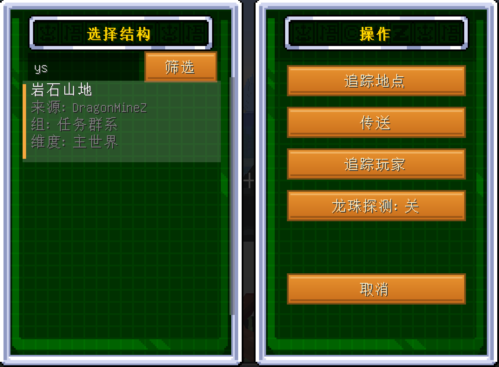
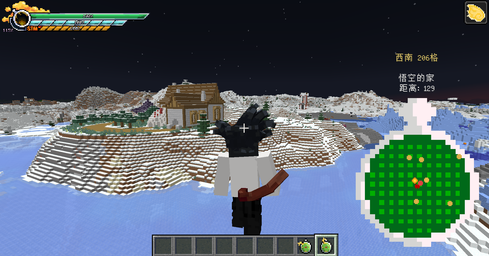
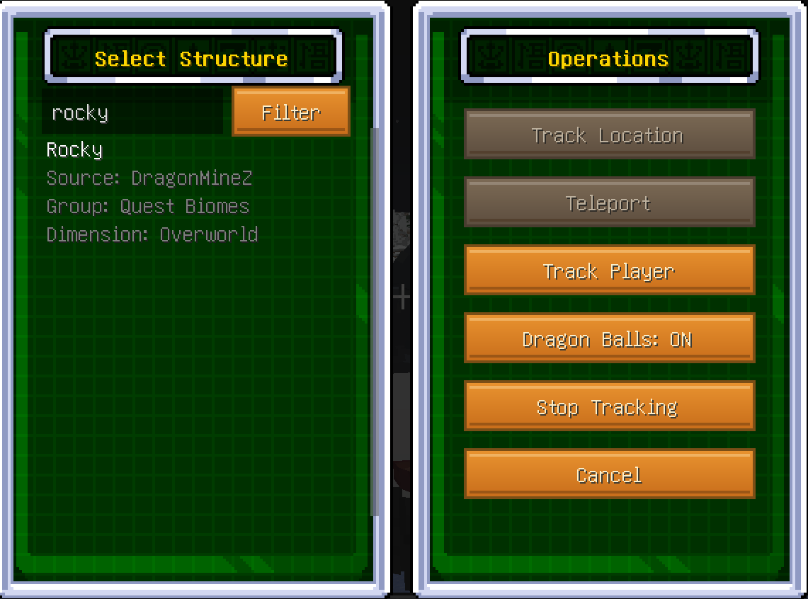
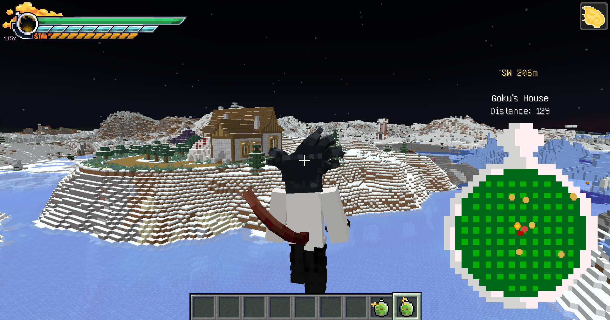

# Biome Radar / 群系雷达

Minecraft 1.20.1 Forge 的一个小 mod，拿来找群系、找结构用的。
基于 [Explorer's Compass](https://github.com/MattCzyr/ExplorersCompass) 改的，加了龙珠雷达那个表盘样式和搜索逻辑。

## 这玩意能干啥

- 搜原版所有结构：村庄、神殿、地牢、废弃传送门、海底神殿……都能找
- 搜群系：海洋、平原、蘑菇岛这些，点一下就指方向
- 装了 DragonMineZ 的话，龙珠里的结构（龟仙屋、天神殿、那美克星大长老家）和任务要去的群系都能搜
- 支持中文搜索，打拼音也行（搜 "pingyuan" 或 "py" 都能找到平原）
- 游戏内语言切中文就全中文，切英文就全英文





## 怎么做出来

基础合成：R 红石，I 铁锭，C 指南针。前期就能做。


装了 DragonMineZ 之后，用雷达加龙珠芯片和 CPU 可以升级成龙珠雷达，额外追踪龙珠：


## 安装

装 [Forge 1.20.1](https://files.minecraftforge.net/)（47.4.26 以上），把 jar 丢 mods 文件夹就行。
装 DragonMineZ 会自动解锁龙珠相关的搜索内容，不装也能用原版功能。

## 自己编译

需要 JDK 17：
```
gradlew build
```

## License

CC BY-NC-SA 4.0，不能商用，改了要注明出处。

---

# English

A simple search-and-point radar mod for Minecraft 1.20.1 Forge.
Forked from [Explorer's Compass](https://github.com/MattCzyr/ExplorersCompass), restyled after the Dragon Ball radar UI.

## What it does

- Search any vanilla structure: villages, temples, strongholds, ruined portals, ocean monuments...
- Search biomes: oceans, plains, mushroom fields, whatever you need
- DragonMineZ integration: locate Roshi's house, Kami's Lookout, Guru's home, and quest biomes
- Auto switches between Chinese and English based on your game language






## Recipe

```
R I R
I C I
R I R
```

R = Redstone, I = Iron Ingot, C = Compass. Easy early game.

## Build

JDK 17, run `gradlew build`.

## License

CC BY-NC-SA 4.0. Non-commercial, credit required.
